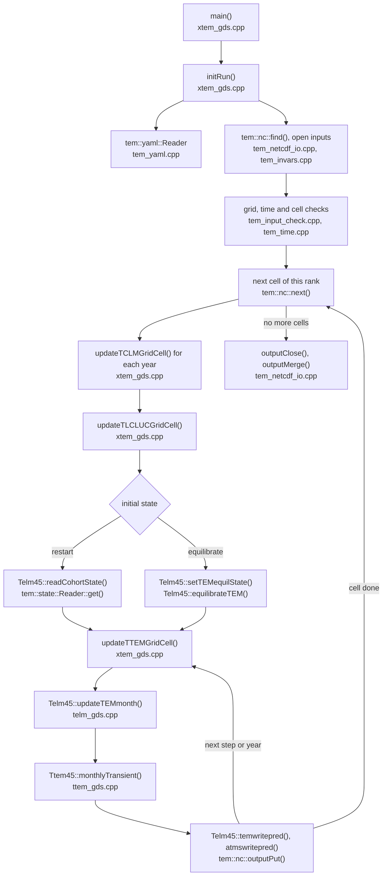
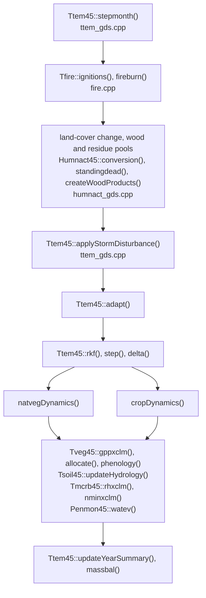

# TEM call hierarchy

`make` builds one executable, `xtem`, from every `src/*/*.cpp`. The driver is [xtem_gds.cpp](src/driver/xtem_gds.cpp) (`main`, the cell and year loops, the input and output wiring) and the cell class is [telm_gds.cpp](src/physics/telm_gds.cpp) (`Telm45`: one cohort, equilibrium, state and output). The ecosystem model is `Ttem45` in [ttem_gds.cpp](src/physics/ttem_gds.cpp), which owns one object of each process class (`Tveg45`, `Tsoil45`, `Tmcrb45`, `Penmon45`, `Humnact45`, `Tfire`). The key `competition` selects whether the cohorts of a cell take the steps of a year in turn (0) or each step together (1).

## Run

Each box gives the function and the file it is in.

## One model step

`Ttem45::stepmonth()` runs one step of any length (the name is historical). `Telm45::equilibrateTEM()` calls it during the equilibrium and `Ttem45::monthlyTransient()` during the transient run.

## Where the code is

| File | Content | Main functions and classes |
| --- | --- | --- |
| [xtem_gds.cpp](src/driver/xtem_gds.cpp) | driver | `main`, `initRun`, `updateTCLMGridCell`, `updateTLCLUCGridCell`, `updateTTEMGridCell`, `initializeTEMGridCell`; reads `tem_config.yaml`; the cohort and step loops |
| [telm_gds.cpp](src/physics/telm_gds.cpp), [.h](src/physics/telm_gds.h), [telmntcohort_gds.hpp](src/physics/telmntcohort_gds.hpp) | one cell and its cohorts | `Telm45::setTEMequilState`, `equilibrateTEM`, `updateTEMmonth`, `temwritepred`, `atmswritepred`, `readCohortState`, `writeCohortState` |
| [ttem_gds.cpp](src/physics/ttem_gds.cpp), [.h](src/physics/ttem_gds.h) | ecosystem model | `Ttem45::stepmonth`, `monthlyTransient`, `adapt`, `rkf`, `step`, `delta`, `natvegDynamics`, `cropDynamics`, `applyStormDisturbance`, `updateYearSummary`, `loadSiteCalibrations` |
| [fire.cpp](src/physics/fire.cpp), [.h](src/physics/fire.h) | wildfire (GDSTEM-FIRE) | `Tfire::ignitions`, `Tfire::fireburn` |
| [tveg_gds.cpp](src/physics/tveg_gds.cpp), [.h](src/physics/tveg_gds.h) | vegetation | `Tveg45::updateDynamics`, `gppxclm`, `nupxclm`, `phenology`, `allocate`, `getecd` (also the fire parameters) |
| [tsoil_gds.cpp](src/physics/tsoil_gds.cpp), [.h](src/physics/tsoil_gds.h) | soil and hydrology | `Tsoil45::updateHydrology`, `snowmelt`, `percol`, `updateRootZ`, `updateNLosses` |
| [tmcrb_gds.cpp](src/physics/tmcrb_gds.cpp), [.h](src/physics/tmcrb_gds.h) | microbes | `Tmcrb45::updateDynamics`, `rhxclm`, `nminxclm`, `yrkd` |
| [penmon_gds.cpp](src/physics/penmon_gds.cpp), [.h](src/physics/penmon_gds.h) | evapotranspiration | `Penmon45::watev`, `gcpet`, `hydraulics` |
| [humnact_gds.cpp](src/physics/humnact_gds.cpp), [.h](src/physics/humnact_gds.h) | land use, wood and residue pools | `Humnact45::conversion`, `harvest`, `grazing`, `createWoodProducts`, `updatestanddead` |
| [tclm_gds.cpp](src/physics/tclm_gds.cpp), [atms_gds.cpp](src/physics/atms_gds.cpp) | radiation, nitrogen deposition, atmosphere | `Tclm45::xnirr`, `xpar`, `mkclds`, `mkd40` |
| [tclmdat_gds.cpp](src/physics/tclmdat_gds.cpp), [tlcluc_gds.cpp](src/physics/tlcluc_gds.cpp), [lulcdat_gds.cpp](src/physics/lulcdat_gds.cpp), [telvdat_gds.cpp](src/physics/telvdat_gds.cpp), [tsoldat_gds.cpp](src/physics/tsoldat_gds.cpp), [atmdepdat_gds.cpp](src/physics/atmdepdat_gds.cpp), [nfertdat_gds.cpp](src/physics/nfertdat_gds.cpp) | records of one cell and year read from the inputs | `Lulcdat45::read`, `Atmdepdat::read`, `Nfertdat::read` |
| [ttimestep.h](src/physics/ttimestep.h), [tem_time.cpp](src/physics/tem_time.cpp), [.h](src/physics/tem_time.h) | time in seconds | `getTimestep45()`, `rateToStep`, `secondsToSteps`, `stepShareOfMonth`, `tem_time::unitToSeconds`, `parseCFUnits`, `decodeCF` |
| [tem_input_check.cpp](src/io/tem_input_check.cpp), [.h](src/io/tem_input_check.h) | validation of the inputs | `tem_check::geoAxis`, `matchAxis`, `timeSpacing`, `timeCoversRun`, `StartYear`, `Domain`; grid: `readGrid`, `sameGrid` |
| [tem_netcdf_io.cpp](src/io/tem_netcdf_io.cpp), [.h](src/io/tem_netcdf_io.h) | NetCDF inputs and the output file | `tem::nc::find`, `next`, `setRunLength`, `setRunStart`, `setPartition`, `configureOutput`, `outputPut`, `outputMerge` |
| [tem_log.cpp](src/io/tem_log.cpp), [.h](src/io/tem_log.h) | tem_<id>.out and tem_<id>.log for all ranks, fatal errors that stop every rank | `tem::log::open`, `root`, `cell`, `fatal`, `fatalRoot` |
| [tem_invars.cpp](src/io/tem_invars.cpp), [tem_outvars.cpp](src/io/tem_outvars.cpp) | input specification (`varmap`), output variable registry | `inputSpec` (checks that the input is on the land-cover grid), `registerOutput` |
| [tem_state_io.cpp](src/io/tem_state_io.cpp), [.h](src/io/tem_state_io.h) | restart file | `tem::state::Writer::put`, `Reader::get` |
| [tem_yaml.cpp](src/io/tem_yaml.cpp), [.h](src/io/tem_yaml.h) | YAML for the configuration and the parameter files | `tem::yaml::Reader` |
| [mpi_parallel.cpp](src/io/mpi_parallel.cpp), [mpi_serial.cpp](src/io/mpi_serial.cpp), [mpi_layer.h](src/io/mpi_layer.h) | MPI layer (`make mpi`) or the serial stand-in | `init`, `rank`, `size`, `barrier`, `finalize` |
| [tbiome_gds.cpp](src/physics/tbiome_gds.cpp), [elmnt_gds.cpp](src/physics/elmnt_gds.cpp), [tmaxcohortdat_gds.cpp](src/physics/tmaxcohortdat_gds.cpp), [bioms_gds.hpp](src/physics/bioms_gds.hpp), [temconsts_gds.hpp](src/physics/temconsts_gds.hpp) | biome and element types, constants | `Biome45`, `Elmnt45`, `MaxCohortdat45` |

Not in `src/`: [tests/](tests/) holds the unit tests (`make test`), [params/](params/) the parameter YAML files and [templates/tem_config.yaml](templates/tem_config.yaml) the configuration with every key.
